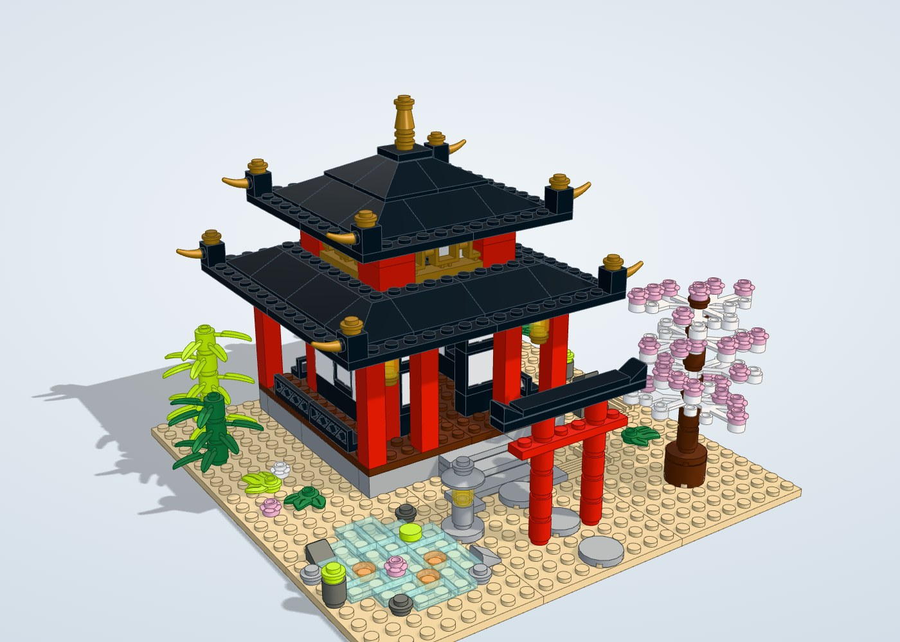

# BrickMatch

Diseñá un modelo con piezas LEGO® reales, miralo en 3D y averiguá qué set trae
la mayoría de esas piezas para comprarlo y armar tu diseño en vez del oficial.

Proyecto independiente del resto del repo: vive entero en esta carpeta.


| Pabellón Zen: 285 piezas, 100 % con el set 10315 | Templo Zen Ninjago: 307 piezas, diseño libre | Base Ninja: 111 piezas, 100 % con el set 71826 |
| --- | --- | --- |
|  |  |  |

## Cómo se usa

1. Le pedís un modelo a Claude por chat ("quiero una casa Zen Ninjago").
2. Claude lo escribe pieza por pieza en `models/<id>/model.mjs` y corre el flujo:
   arma el modelo, lo **valida físicamente**, saca renders para revisarlo y
   **busca en todos los sets** cuál cubre más piezas.
3. Lo ves en la mini app: modelo 3D, pasos de armado, lista de piezas y ranking
   de sets. Al elegir un set, el modelo marca en rojo lo que te faltaría.
4. Si el modelo es para tus minifiguras, se colocan **minifiguras de prueba**:
   el validador confirma que entran sin chocar y el visor las muestra u oculta.
   Lo mismo con un **volumen de prueba** del tamaño de un vehículo que tiene
   que entrar: se dibuja como una caja de vidrio.

Cuando ningún set cubre lo suficiente, el diseño se adapta a un set concreto.
Si el pedido es "con un set barato", se elige primero la caja y se diseña solo
con lo que trae. Los modelos de ejemplo muestran la diferencia:

| Modelo | Piezas | Mejor set | Cobertura exacta |
| --- | --- | --- | --- |
| `pabellon-zen` (adaptado) | 285 | 10315 Tranquil Garden (1.363 piezas) | 285 de 285, **100 %** |
| `templo-zen` (diseño libre) | 307 | 71861 The Old Town (4.852 piezas) | 106 de 307, 34,5 % |
| `base-ninja` (set barato) | 111 | 71826 Dragon Spinjitzu Battle Pack (186 piezas) | 111 de 111, **100 %** |
| `base-universal` (para 30 minifiguras) | 573 | 70751 Temple of Airjitzu (2.033 piezas) | 573 de 573, **100 %** |
| `fortaleza-ninja` (cuartel amurallado de 49 × 54 cm) | 1.034 | 70751 Temple of Airjitzu (2.033 piezas) | 1.034 de 1.034, **100 %** |

`base-universal` y `fortaleza-ninja` usan como donante un set retirado: el
original se consigue usado, y es de los más copiados por marcas alternativas,
que es la forma barata de conseguir las mismas piezas. El segundo mejor set
solo cubre el 24 %. `fortaleza-ninja` reutiliza el código de `base-universal`
y lo convierte en un cuartel con la misma caja: sala de operaciones, torre de
control y equipo técnico en el edificio y, adelante, un patio de armas
amurallado con dos torres, armería, taller y lugar para un vehículo. Usa piezas
que en la primera quedaban sin usar: las 34 persianas negras del set son los
techos de las galerías. Va en módulos apoyados sobre la mesa, como el patio de
un castillo.

| Armería: racks de lanzas y espadas bajo el techo de persianas | Taller del vehículo: banco, rueda de repuesto y cajón |
| --- | --- |
|  |  |

## Comandos

```bash
npm install
npm run data                     # baja piezas 3D + base de sets y arma el índice (una vez, ~600 MB)
npm run model -- pabellon-zen    # arma, valida y rankea sets → model.ldr, model.mpd, report.json
npm run viewer                   # construye la mini app en dist/
npm run serve                    # la abre en http://localhost:4173
npm run render -- pabellon-zen   # capturas para revisar (hero, lado, frente, atras, arriba, detalle)
npm run render -- base-universal --no-figs   # lo mismo, sin las minifiguras de prueba
npm run render -- fortaleza-ninja --no-vol   # sin el volumen de prueba del vehículo
npm run render -- fortaleza-ninja --views=-70:18:1 --focus=50,6,-16,30 --name=armeria   # de cerca: punto (studs, plates, studs) y distancia
```

Herramientas para diseñar:

```bash
node scripts/inspect-part.mjs 3675 3297        # medidas, studs y orientación de una pieza
node scripts/part-info.mjs 3675                # en qué colores existe y en cuántos sets salió
node scripts/part-info.mjs --find "slope 33"   # buscar piezas por nombre
node scripts/set-summary.mjs 10315-1           # inventario de un set, por categoría
node scripts/who-has.mjs 3675 4 --max=3000     # qué sets traen más de una pieza
node scripts/coverage.mjs templo-zen --max=2500    # ranking filtrado por tamaño
node scripts/coverage.mjs pabellon-zen 10315-1     # qué falta con un set y qué alternativas trae
node scripts/donors.mjs --theme=ninjago --max=300  # cajas chicas con más pieza de construcción
node scripts/set-usable.mjs 71826-1            # piezas de construcción de un set que se pueden dibujar
node scripts/set-colors.mjs 71826-1            # inventario de un set agrupado por color
node scripts/budget.mjs base-universal 70751-1 --left   # sobregiros y qué queda sin usar en la caja
node scripts/budget.mjs <modelo> <set> --copies=2       # lo mismo contando dos cajas iguales
node scripts/selftest.mjs                      # pruebas del validador
```

## Cómo se escribe un modelo

Grilla en studs (x, z) y plates (y). Cada pieza se coloca por la esquina de su
huella y la altura de su base; el número y el color son los reales.

```js
export const meta = { title: 'Casita', prompt: 'una casita', description: '…' };

export default function build(m, { rect, fill, roofRing }) {
  m.step('Base');
  rect('plate', 'Green', 0, 0, 0, 8, 8);            // plate 8x8
  m.step('Paredes');
  m.add('3062b', 'Red', 0, 1, 0);                   // ladrillo redondo 1x1
  m.add('3040b', 'Black', 2, 4, 0, { face: 'S' });  // pendiente mirando al frente
  m.step('Techo');
  roofRing('Black', 0, 7, 0, 8, 8);                 // faldón de techo a 33°
}
```

`m.onStud(pieza, n, …)` encastra sobre un stud concreto (sirve para studs
laterales) y `{ on: otraPieza }` declara uniones que no son por stud (barras,
vidrios en su marco).

`m.fig(x, y, z, { face: 'S', color: 'Red', hat: '93059' })` para una minifigura
de prueba sobre dos studs. No entra en la lista de piezas ni en la búsqueda de
sets: sirve para comprobar cuántas entran y dónde. Sobre la mesa (y = 0) vale
parada sin studs. `m.envelope(x, y, z, ancho, fondo, alto)` agrega un volumen de
prueba (un vehículo que tiene que entrar): se comprueba que no choque con nada.
`meta.order` decide qué modelo abre primero la mini app (el más alto) y
`meta.copies` cuántas cajas iguales del set se cuentan en la búsqueda.

Una pieza ya colocada se puede inclinar cambiando su matriz (así están hechos
los techos con bisagra de `fortaleza-ninja`): el validador trabaja con la
geometría girada.

## Qué revisa el validador

Trabaja con la geometría real de cada pieza, no con cajas:

- **Choques**: dos piezas que se atraviesan.
- **Studs**: cada stud tapado tiene que entrar en un encastre de la pieza de
  arriba. Si la pieza está corrida medio stud, lo marca como aplastado.
- **Conexión**: toda pieza tiene que estar encastrada en algo que llegue al
  suelo, y avisa si el modelo queda en bloques sueltos.
- **Existencia**: cada pieza en ese color tiene que haber salido en algún set.
  También avisa si es rara o si el número significa piezas distintas en los
  dos catálogos.

- **Minifiguras de prueba**: cada una tiene que tener los dos pies sobre studs
  (o estar parada en la mesa) y no tocar nada: ni paredes, ni muebles, ni a
  otra minifigura. Los volúmenes de prueba tampoco pueden tocar nada.

No calcula resistencia: una pieza sostenida por un solo stud cuenta como unida.

## Cómo se rankean los sets

Para cada uno de los 21.383 sets con inventario se usa la última versión del
inventario, más las piezas de sus minifiguras y de los sets incluidos en packs.

- **Exacto**: misma pieza (las variantes de molde cuentan como la misma) y mismo color.
- **Forma**: la misma pieza en cualquier color, incluidas versiones impresas.
- **Repuestos**: las piezas extra de la caja se cuentan aparte y son opcionales.

El reporte guarda los 400 mejores sets por color exacto, los 150 mejores por
forma y, para los 12 primeros, el mejor segundo set para completar lo que falta.

## Carpetas

```
lib/        motor: ldraw (geometría), builder (colocar piezas), validate, catalog, match, palette, helpers
scripts/    comandos de arriba
models/     un modelo por carpeta: model.mjs (fuente) + model.ldr, model.mpd, figs.mpd, report.json, renders/
viewer/     mini app (three.js): page.html + src/
data/       datos bajados (no se versiona)
dist/       mini app construida (no se versiona)
```

`model.ldr` es LDraw estándar con los pasos: se abre en BrickLink Studio, LeoCAD o LDView.

## Límites conocidos

- La librería de piezas 3D es la edición 2023-03 de LDraw (la del paquete de
  Ubuntu): no hay piezas posteriores. Con `LDRAW_DIR` se puede apuntar a una más nueva.
- Las piezas impresas se dibujan sin el dibujo; los modelos de ejemplo no usan ninguna.
- La base de sets no trae precios ni disponibilidad en tiendas: el precio de un
  set candidato se busca aparte y `donors.mjs` usa el tamaño de la caja como guía.

## Datos y créditos

- Geometría de piezas: [LDraw](https://www.ldraw.org/) Parts Library, CC BY 4.0.
- Sets, inventarios y colores: [Rebrickable](https://rebrickable.com/downloads/),
  empaquetados como SQLite por [rb.db](https://github.com/ojuuji/rb.db).
- Visor: [three.js](https://threejs.org/) y su `LDrawLoader`.

LEGO® es una marca de The LEGO Group, que no patrocina ni avala este proyecto.
