# BrickMatch

Diseñá un modelo con piezas LEGO® reales, miralo en 3D y averiguá qué set trae
la mayoría de esas piezas para comprarlo y armar tu diseño en vez del oficial.

Proyecto independiente del resto del repo: vive entero en esta carpeta.

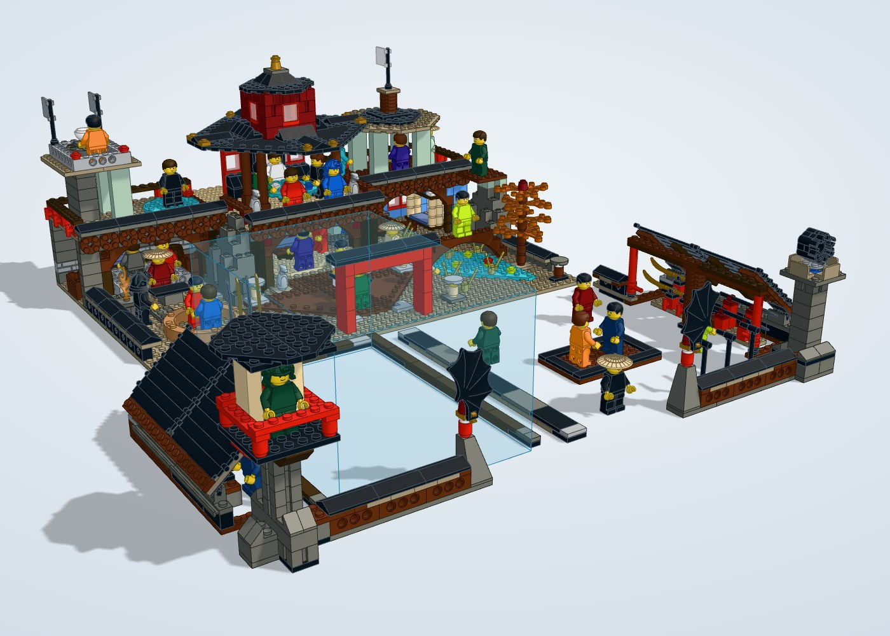

| Pabellón Zen: 285 piezas, 100 % con el set 10315 | Templo Zen Ninjago: 307 piezas, diseño libre | Base Ninja: 111 piezas, 100 % con el set 71826 |
| --- | --- | --- |
| 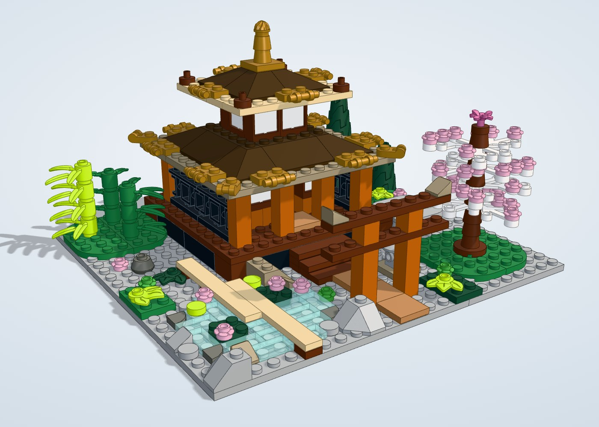 |  | 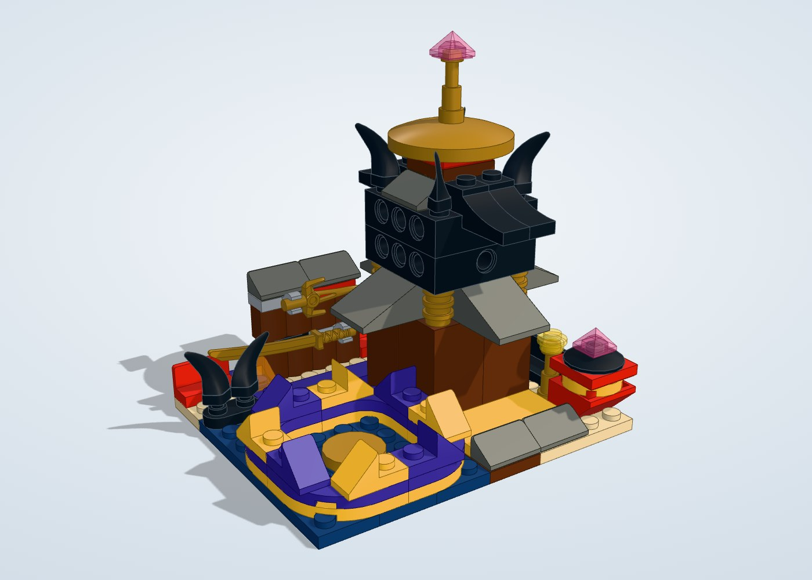 |

## Cómo se usa

1. Le pedís un modelo a Claude por chat ("quiero una casa Zen Ninjago").
2. Claude lo escribe pieza por pieza en `models/<id>/model.mjs` y corre el flujo:
   arma el modelo, lo **valida físicamente**, saca renders para revisarlo y
   **busca en todos los sets** cuál cubre más piezas.
3. Lo ves en la mini app: modelo 3D, **instrucciones de armado paso a paso**,
   lista de piezas y ranking de sets. Al elegir un set, el modelo marca en rojo
   lo que te faltaría. Las mismas instrucciones salen en un cuadernillo PDF.
   El botón **Instrucciones** está sobre el visor y retoma en el paso donde
   quedaste; **Vista real** muestra el modelo como se vería armado, sin los
   bordes dibujados ni las siluetas de vidrio.
4. Si el modelo es para tus minifiguras, se colocan **minifiguras de prueba**:
   el validador confirma que entran sin chocar y el visor las muestra u oculta.
   Lo mismo con un **volumen de prueba** del tamaño de algo que tiene que
   entrar (un vehículo, un mecha de otro set): se dibuja como una silueta de
   vidrio y se apaga con un botón.

Cuando ningún set cubre lo suficiente, el diseño se adapta a un set concreto.
Si el pedido es "con un set barato", se elige primero la caja y se diseña solo
con lo que trae. Los modelos de ejemplo muestran la diferencia:

| Modelo | Piezas | Mejor set | Cobertura exacta |
| --- | --- | --- | --- |
| `pabellon-zen` (adaptado) | 285 | 10315 Tranquil Garden (1.363 piezas) | 285 de 285, **100 %** |
| `templo-zen` (diseño libre) | 307 | 71861 The Old Town (4.852 piezas) | 106 de 307, 34,5 % |
| `base-ninja` (set barato) | 111 | 71826 Dragon Spinjitzu Battle Pack (186 piezas) | 111 de 111, **100 %** |
| `base-universal` (para 30 minifiguras) | 574 | 70751 Temple of Airjitzu (2.033 piezas) | 574 de 574, **100 %** |
| `fortaleza-ninja` (cuartel amurallado de 50 × 54 cm) | 1.099 | 70751 Temple of Airjitzu (2.033 piezas) | 1.099 de 1.099, **100 %** |
| `ciudadela-ninja` (la base ampliada, dos cajas, 73 × 57 cm) | 1.855 | 70751 Temple of Airjitzu + 71848 The Temple Bounty | 1.855 de 1.855, **100 %** entre las dos |

`base-universal` y `fortaleza-ninja` usan como donante un set retirado: el
original se consigue usado, y es de los más copiados por marcas alternativas,
que es la forma barata de conseguir las mismas piezas. El segundo mejor set
solo cubre el 23 %. `fortaleza-ninja` reutiliza el código de `base-universal`
y lo convierte en un cuartel con la misma caja: sala de operaciones, torre de
control y equipo técnico en el edificio y, adelante, un patio de armas
amurallado con dos torres, armería, taller, lugar para un vehículo y lugar para
un mecha de otro set (un podio junto al portón, como las estatuas guardianas de
los templos, y un armero de ejes para su espada). Usa piezas que en la primera quedaban sin usar: 32 de las 34
persianas negras del set son los techos de las galerías, y con lo que sobraba salieron el
gong de alarma, un carro de provisiones, un muñeco de práctica y un farol. Va en
módulos apoyados sobre la mesa, como el patio de un castillo.

Las 1.099 piezas están en la caja con el mismo número de pieza y el mismo
color, sin contar los repuestos. Las 105 uniones que no son stud con stud
(clips, bisagras, ejes, vidrios en su marco) se comprobaron una por una: las
dos piezas se tocan y ninguna atraviesa a la otra. Lo único que va apoyado y no
a presión son las 32 persianas de los techos, que quedan calzadas entre los
studs de los cabios. Las instrucciones de armado (220 pasos en 72 capítulos)
están en el botón Instrucciones de la mini app y en
[`models/fortaleza-ninja/instrucciones.pdf`](models/fortaleza-ninja/instrucciones.pdf).

| Armería: racks de lanzas y espadas bajo el techo de persianas | Taller del vehículo: banco, rueda de repuesto y cajón |
| --- | --- |
| 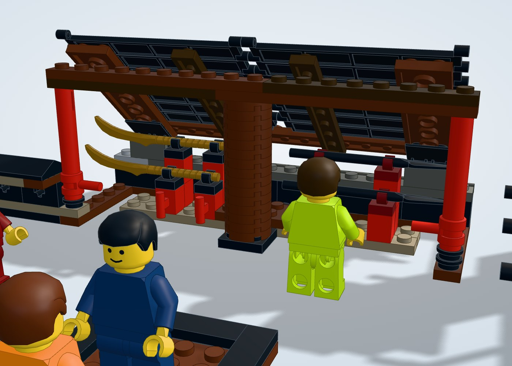 | 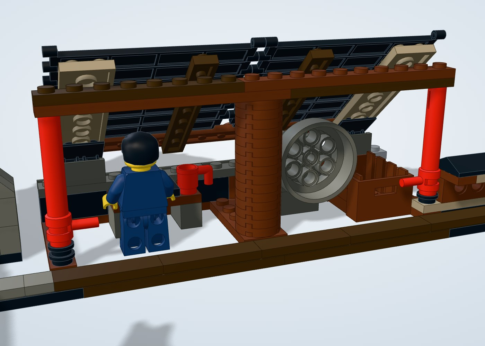 |

| Lugar del mecha: podio junto al portón y armero de ejes | Gong de alarma en el patio interior |
| --- | --- |
| 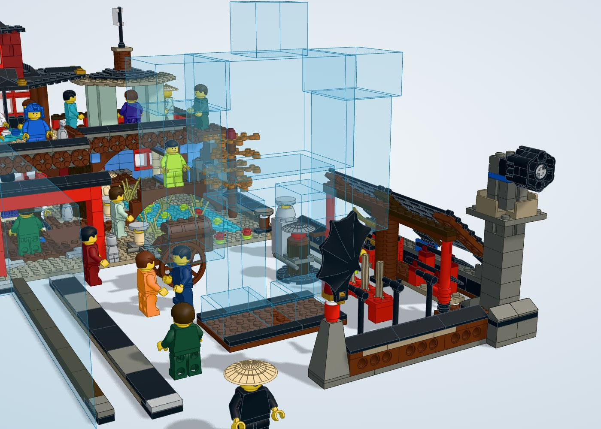 | 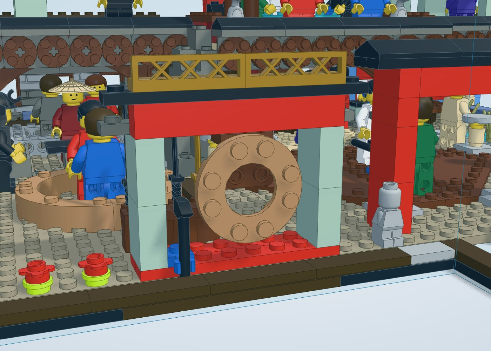 |

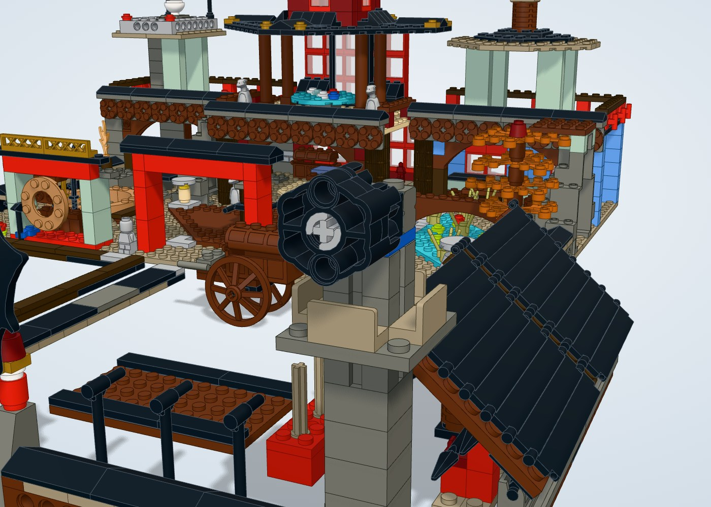

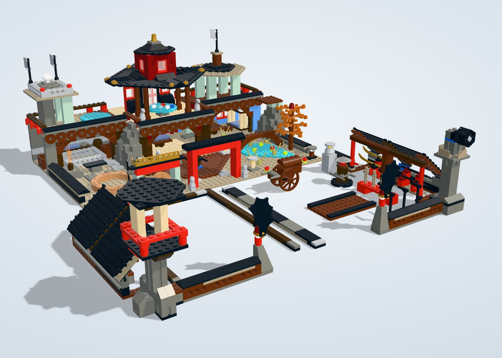

### La ampliación: Ciudadela Ninja (dos cajas)

`ciudadela-ninja` es la misma base con lo que suma un segundo set desarmado, el
71848 The Temple Bounty. Reutiliza el código de `fortaleza-ninja` (le saca el
muro del frente, el portón y los cierres laterales) y la lleva de 1.099 a
1.855 piezas:

- **Muralla**: dos paños de troncos claros con entramado oscuro, una franja de
  cuatro ventanas con celosía dorada, albardilla negra y crestería de rejas.
- **Portón de templo**: postes de troncos de 2×2, viga de tres capas con ocho
  ménsulas, y un techo cóncavo de veinte tejas (los parabrisas negros del
  barco, dados vuelta y abrochados por su barra al alero), con cumbrera de
  lingotes dorados y un rulo dorado en cada punta. Abajo siguen pasando los 20
  studs × 36 plates del vehículo.
- **Explanada y avenida** con ocho faroles (la luz es una cabeza celeste),
  diez katanas doradas en clips del lado de adentro de la muralla y dos pasos
  laterales con arco entre las galerías y el edificio.
- **Ala oeste** (`tea.mjs`), a la que se sale por el paso lateral: la **casa
  de té**, con techo de paja hecho con doce de los paneles curvos del casco,
  cumbrera con rollizos y flores doradas, dos mostradores de cajones (tejuelas
  con manija sobre escuadras), tarima roja con la mesa y la tetera, y una
  terraza con baranda roja; un **aljibe techado** con los otros cuatro paneles;
  senderos con piedras para pisar y tres faroles.

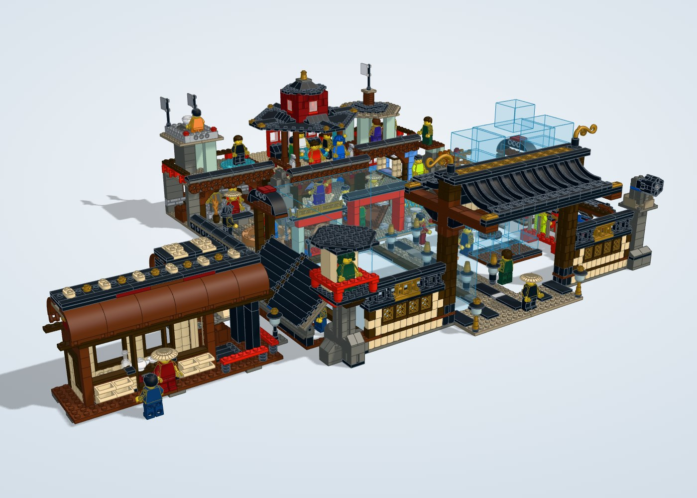

| De frente | Vista real, sin minifiguras |
| --- | --- |
| 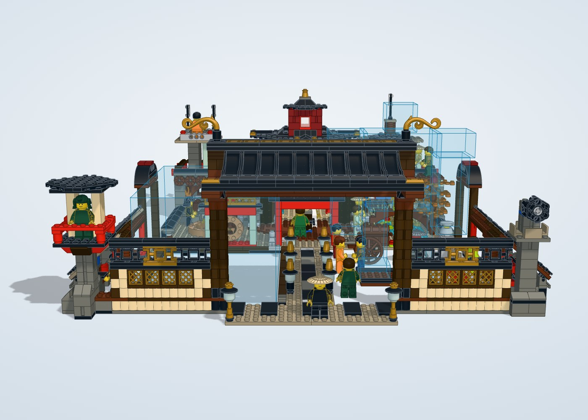 | 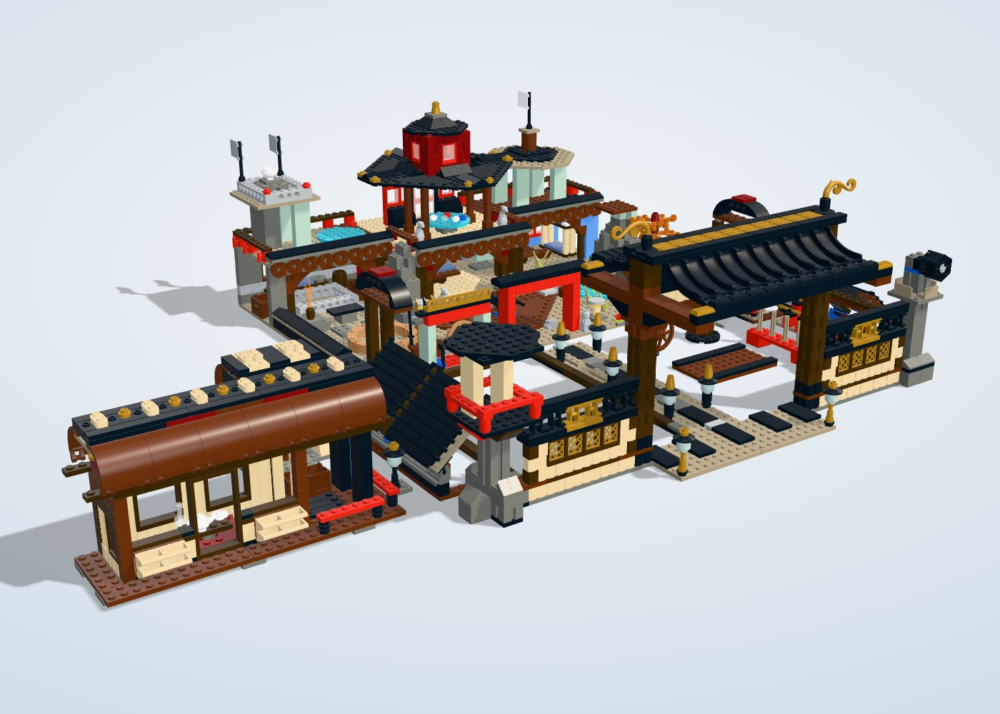 |

| El portón: techo de tejas, cumbrera dorada y faroles | La avenida, vista desde el patio | Diez katanas doradas del lado de adentro |
| --- | --- | --- |
| 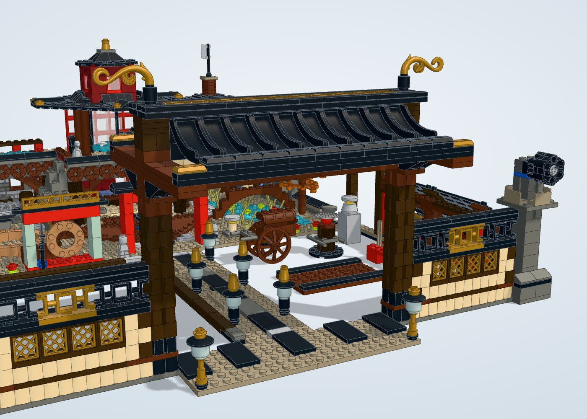 | 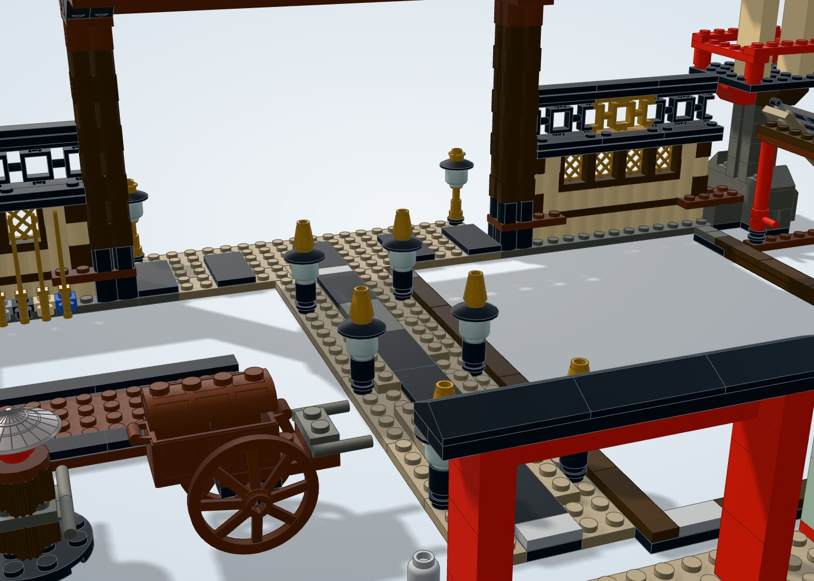 | 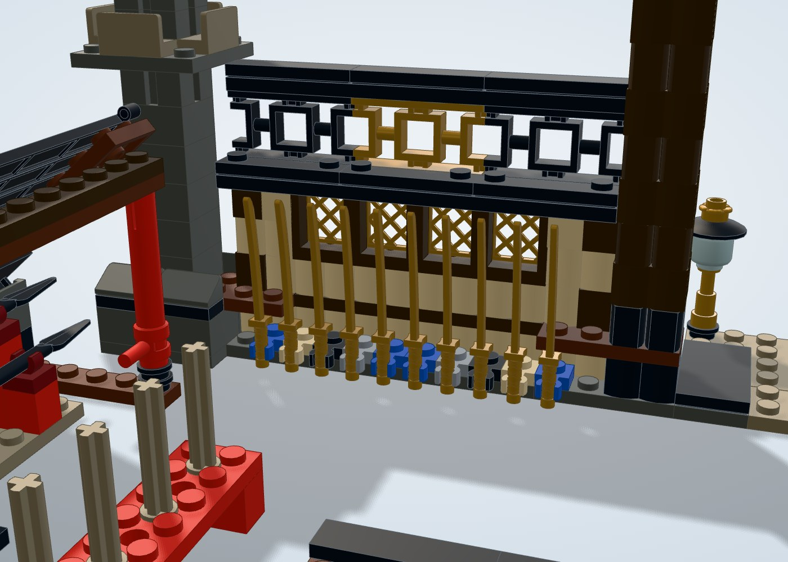 |

| La casa de té: techo de paja con los paneles del casco | El aljibe y el fondo de la casa de té |
| --- | --- |
| 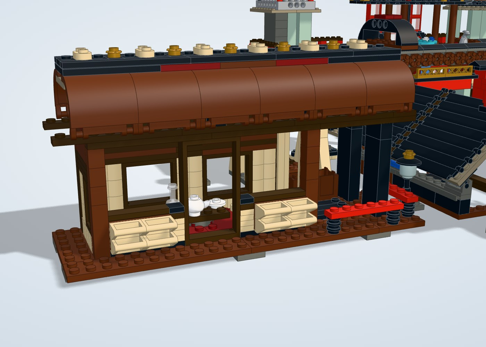 | 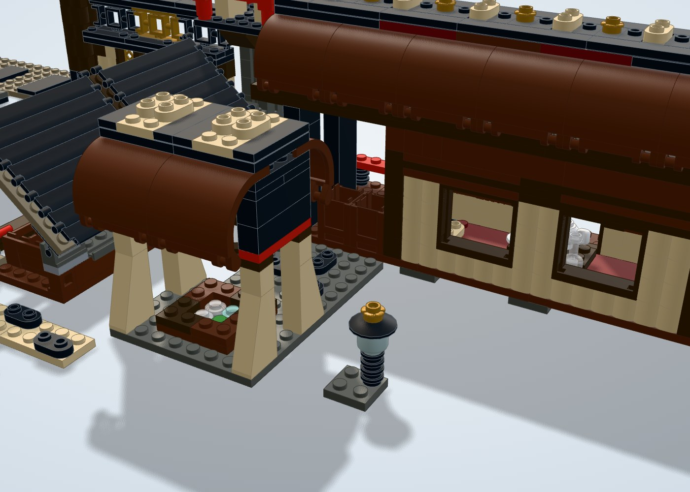 |

Las 1.855 piezas salen de las dos cajas sin repuestos (`meta.donors` las
declara, y la mini app abre con las dos ya comparadas). Las instrucciones son
355 pasos en 99 capítulos:
[`models/ciudadela-ninja/instrucciones.pdf`](models/ciudadela-ninja/instrucciones.pdf).

**Cuánto del segundo set se aprovecha.** Del Temple Bounty entran 744 de sus
2.388 piezas (31 %); la lista está en
[`models/ciudadela-ninja/piezas-del-bounty.csv`](models/ciudadela-ninja/piezas-del-bounty.csv).
Con la primera versión, sin el ala oeste, eran 419 (18 %). Lo que sigue
quedando afuera no mejora un edificio: 254 piezas son Technic (el mecanismo del
barco), unas 170 son escuadras y unas 85 son placas de un stud centrado que van
por dentro, y además están las velas de tela y seis minifiguras. Quedaron
afuera a propósito las dos puertas de empalizada: ninguna pieza de las dos
cajas las deja colgadas sin chocar en el modelo 3D, y no se dibuja nada que no
esté comprobado. Tampoco hay geometría LDraw para las velas, la cabeza de
dragón ni algunas pendientes nuevas.

## Comandos

```bash
npm install
npm run data                     # baja piezas 3D + base de sets y arma el índice (una vez, ~600 MB)
npm run model -- pabellon-zen    # arma, valida y rankea sets → model.ldr, model.mpd, report.json
npm run viewer                   # construye la mini app en dist/
npm run serve                    # la abre en http://localhost:4173
npm run instructions -- fortaleza-ninja   # cuadernillo PDF: una página por paso de armado (después de npm run viewer)
npm run render -- pabellon-zen   # capturas para revisar (hero, lado, frente, atras, arriba, detalle)
npm run render -- base-universal --no-figs   # lo mismo, sin las minifiguras de prueba
npm run render -- fortaleza-ninja --no-vol   # sin el volumen de prueba del vehículo
npm run render -- fortaleza-ninja --real     # vista real: sin bordes dibujados ni siluetas de vidrio
npm run render -- fortaleza-ninja --views=-70:18:1 --focus=50,6,-16,30 --name=armeria   # de cerca: punto (studs, plates, studs) y distancia
```

Herramientas para diseñar:

```bash
node scripts/inspect-part.mjs 3675 3297        # medidas, studs y orientación de una pieza
node scripts/part-info.mjs 3675                # en qué colores existe y en cuántos sets salió
node scripts/part-info.mjs --find "slope 33"   # buscar piezas por nombre
node scripts/set-summary.mjs 10315-1           # inventario de un set, por categoría
node scripts/who-has.mjs 3675 4 --max=3000     # qué sets traen más de una pieza
node scripts/coverage.mjs templo-zen --max=2500    # ranking filtrado por tamaño
node scripts/coverage.mjs pabellon-zen 10315-1     # qué falta con un set y qué alternativas trae
node scripts/donors.mjs --theme=ninjago --max=300  # cajas chicas con más pieza de construcción
node scripts/set-usable.mjs 71826-1            # piezas de construcción de un set que se pueden dibujar
node scripts/set-colors.mjs 71826-1            # inventario de un set agrupado por color
node scripts/budget.mjs base-universal 70751-1 --left   # sobregiros y qué queda sin usar en la caja
node scripts/budget.mjs <modelo> <set> --copies=2       # lo mismo contando dos cajas iguales
node scripts/budget.mjs ciudadela-ninja 70751-1+71848-1 --left --from=71848-1   # dos cajas distintas: qué queda de la segunda
node scripts/budget.mjs ciudadela-ninja 70751-1+71848-1 --taken=71848-1 --csv=lista.csv   # qué piezas salen de la segunda caja
node scripts/selftest.mjs                      # pruebas del validador
```

## Cómo se escribe un modelo

Grilla en studs (x, z) y plates (y). Cada pieza se coloca por la esquina de su
huella y la altura de su base; el número y el color son los reales.

```js
export const meta = { title: 'Casita', prompt: 'una casita', description: '…' };

export default function build(m, { rect, fill, roofRing }) {
  m.step('Base');
  rect('plate', 'Green', 0, 0, 0, 8, 8);            // plate 8x8
  m.step('Paredes');
  m.add('3062b', 'Red', 0, 1, 0);                   // ladrillo redondo 1x1
  m.add('3040b', 'Black', 2, 4, 0, { face: 'S' });  // pendiente mirando al frente
  m.step('Techo');
  roofRing('Black', 0, 7, 0, 8, 8);                 // faldón de techo a 33°
}
```

`m.onStud(pieza, n, …)` encastra sobre un stud concreto (sirve para studs
laterales) y `{ on: otraPieza }` declara uniones que no son por stud (barras en
clips, bisagras, ejes, vidrios en su marco). Declararla no la da por buena: el
validador comprueba que las dos piezas se toquen y no se atraviesen. Con
`{ on: otraPieza, rest: true }` la pieza va solo apoyada (por su peso) y el
reporte la lista aparte.

`m.step('Título', 'indicación')` empieza un capítulo del armado; la indicación
(cómo va una unión, qué queda apoyado) aparece en las instrucciones. Si el
modelo exporta `buildOrder = [['Parte', ['Título', …]], …]`, los capítulos se
construyen en ese orden (lo de adentro antes de cerrar con el piso de arriba).

`m.fig(x, y, z, { face: 'S', color: 'Red', hat: '93059' })` para una minifigura
de prueba sobre dos studs. No entra en la lista de piezas ni en la búsqueda de
sets: sirve para comprobar cuántas entran y dónde. Sobre la mesa (y = 0) vale
parada sin studs. `m.envelope(x, y, z, ancho, fondo, alto, { label })` agrega un
volumen de prueba (un vehículo que tiene que entrar): se comprueba que no choque
con nada. Varias cajas con la misma etiqueta forman una sola silueta.
`meta.order` decide qué modelo abre primero la mini app (el más alto),
`meta.copies` cuántas cajas iguales del set se cuentan en la búsqueda y
`meta.donors` (una lista de números de set) declara que el modelo está pensado
para varias cajas distintas: la mini app y el PDF muestran lo que cubren juntas.

Una pieza ya colocada se puede inclinar cambiando su matriz (así están hechos
los techos con bisagra de `fortaleza-ninja`): el validador trabaja con la
geometría girada.

## Qué revisa el validador

Trabaja con la geometría real de cada pieza, no con cajas:

- **Choques**: dos piezas que se atraviesan. No hay excepciones: también se
  revisan las que se unen por clip, bisagra o eje.
- **Studs**: cada stud tapado tiene que entrar en un encastre de la pieza de
  arriba, que lo apriete de lados opuestos (una pared que lo roza de un solo
  lado no cuenta). Si la pieza está corrida medio stud, lo marca como
  aplastado. Una barra dentro de un stud hueco vale como unión.
- **Uniones declaradas**: en cada unión que no es por stud, las dos piezas
  tienen que estar en contacto.
- **Conexión**: toda pieza tiene que estar encastrada en algo que llegue al
  suelo, y avisa si el modelo queda en bloques sueltos.
- **Existencia**: cada pieza en ese color tiene que haber salido en algún set.
  También avisa si es rara o si el número significa piezas distintas en los
  dos catálogos.

- **Minifiguras de prueba**: cada una tiene que tener los dos pies sobre studs
  (o estar parada en la mesa) y no tocar nada: ni paredes, ni muebles, ni a
  otra minifigura. Los volúmenes de prueba tampoco pueden tocar nada.

No calcula resistencia: una pieza sostenida por un solo stud cuenta como unida.

## Instrucciones de armado

Después de validar, `lib/plan.mjs` arma el plan con las uniones que encontró el
validador:

- **Capítulos**: los pasos con nombre del modelo, en el orden de `buildOrder`.
- **Pasos**: cada capítulo se parte en tandas de 3 a 6 piezas (hasta 8 si son
  todas iguales), de abajo hacia arriba. Una pieza solo entra cuando ya tiene
  dónde encastrar, así que en ningún paso queda algo flotando. Las pilas de
  piezas iguales y lo que va unido a mano (el vidrio con su marco, la katana
  con su clip) van juntos. Si a una pieza la sostiene algo de un capítulo
  posterior, espera hasta ahí.

En la mini app, el botón **Instrucciones** del visor abre el armado en el paso
donde quedaste (se recuerda en el navegador). Cada paso muestra, sobre el
modelo, un recuadro con las piezas que hacen falta y su cantidad; una flecha
roja señala cada pieza nueva, que se ve en su color, y lo ya armado queda
apagado. La vista es la de tres cuartos de siempre y no se mueve mientras los
pasos sean de la misma zona; solo gira si las piezas nuevas quedarían tapadas.

`npm run instructions` genera lo mismo en PDF con formato de manual: dos pasos
por página, el recuadro de piezas al costado y un plano de ubicación. Cada
parte abre con la lista de piezas que usa, para separarlas antes de empezar, y
al final va el inventario completo.

## El visor

Un modelo de mil piezas dibujado pieza por pieza son miles de llamadas a la
placa de video por cuadro, y en un teléfono se traba. `viewer/src/stage.js`
agrupa todo:

- Las mallas van en tres lotes (`BatchedMesh`: plástico, metal y transparente)
  que comparten la geometría de las piezas repetidas. El color, la posición y
  si se ve o no cada pieza van por instancia, así que los pasos de armado y la
  comparación con un set no rompen los lotes.
- Los bordes se dibujan por instancias: una llamada por tipo de pieza.
- Las sombras se recalculan solo cuando cambia el modelo, no en cada cuadro.
- Si aun así el equipo no llega a unos 30 cuadros por segundo, los bordes se
  apagan mientras se mueve el modelo y vuelven al soltar.

En la Base de Operaciones (1.099 piezas más 35 minifiguras) eso baja de unas
5.900 llamadas por cuadro a unas 300, y a 5 en la vista real.

La **vista real** saca los bordes dibujados y las siluetas de vidrio, le da
más brillo al plástico y achica cada pieza un 0,6 % para que se vean las
juntas, como en el modelo armado.

## Cómo se rankean los sets

Para cada uno de los 21.383 sets con inventario se usa la última versión del
inventario, más las piezas de sus minifiguras y de los sets incluidos en packs.

- **Exacto**: misma pieza (las variantes de molde cuentan como la misma) y mismo color.
- **Forma**: la misma pieza en cualquier color, incluidas versiones impresas.
- **Repuestos**: las piezas extra de la caja se cuentan aparte y son opcionales.

El reporte guarda los 400 mejores sets por color exacto, los 150 mejores por
forma y, para los 12 primeros, el mejor segundo set para completar lo que falta.

## Carpetas

```
lib/        motor: ldraw (geometría), builder (colocar piezas), validate, catalog, match, palette, helpers
scripts/    comandos de arriba
models/     un modelo por carpeta: model.mjs (fuente) + model.ldr, model.mpd, figs.mpd, report.json, renders/
viewer/     mini app (three.js): page.html + src/
data/       datos bajados (no se versiona)
dist/       mini app construida (no se versiona)
```

`model.ldr` es LDraw estándar con los pasos: se abre en BrickLink Studio, LeoCAD o LDView.

## Límites conocidos

- La librería de piezas 3D es la edición 2023-03 de LDraw (la del paquete de
  Ubuntu): no hay piezas posteriores. Con `LDRAW_DIR` se puede apuntar a una más nueva.
- Las piezas impresas se dibujan sin el dibujo (los vidrios de las ventanas shoji
  y las tejuelas con dragón de los modelos grandes, por ejemplo).
- La base de sets no trae precios ni disponibilidad en tiendas: el precio de un
  set candidato se busca aparte y `donors.mjs` usa el tamaño de la caja como guía.

## Datos y créditos

- Geometría de piezas: [LDraw](https://www.ldraw.org/) Parts Library, CC BY 4.0.
- Sets, inventarios y colores: [Rebrickable](https://rebrickable.com/downloads/),
  empaquetados como SQLite por [rb.db](https://github.com/ojuuji/rb.db).
- Visor: [three.js](https://threejs.org/) y su `LDrawLoader`.

LEGO® es una marca de The LEGO Group, que no patrocina ni avala este proyecto.
